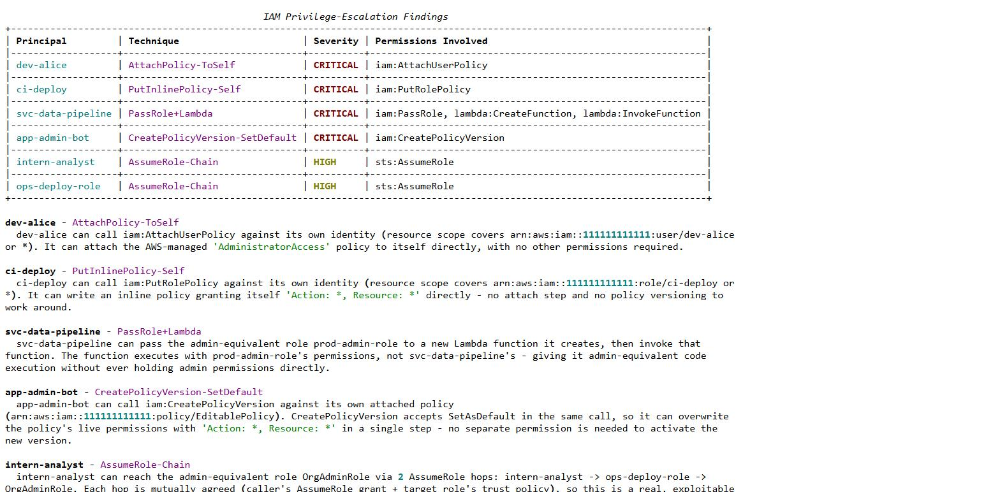
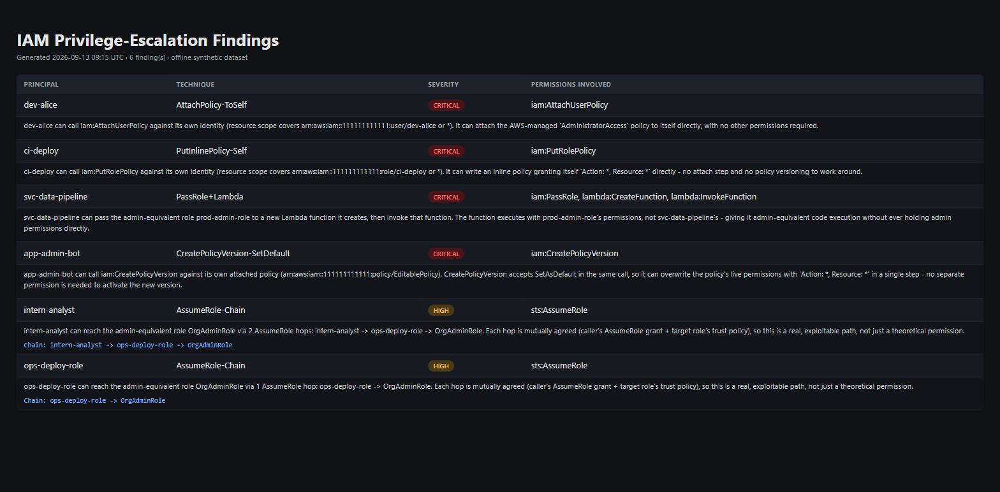

# IAM Privilege-Escalation Path Finder

A small, offline tool that scans a set of AWS IAM policy documents and
identifies known privilege-escalation paths - cases where a principal with
limited permissions can chain a small number of IAM/STS/Lambda API calls to
reach admin-equivalent access, without ever being granted `AdministratorAccess`
directly.

Built as a portfolio project to demonstrate applied IAM security research: the
goal isn't a keyword scanner, it's a tool whose detection logic mirrors the
actual AWS mechanics that make each technique work.

## What it does

Given a JSON file (or directory of JSON files) describing IAM users, roles,
their attached/inline policies, and role trust policies, the tool runs five
independent detectors and reports, for each finding:

- **which principal** has the escalation path
- **which technique** it maps to
- **which specific permissions** enable it
- **a plain-English explanation** of the exploit chain (and the hop-by-hop
  path, for AssumeRole chains)

It is entirely offline - no boto3, no live AWS calls, no real credentials.
Input is synthetic JSON you write or load from `samples/`.

## The five techniques

Each is implemented as its own file in `detectors/`, so each can be read,
tested, and explained independently.

| Detector | AWS mechanic |
|---|---|
| **AttachPolicy-ToSelf** (`attach_policy_to_self.py`) | `iam:AttachUserPolicy` / `iam:AttachRolePolicy` is a *separate* permission from having the permissions themselves. A principal that can call it against its own ARN can attach AWS's managed `AdministratorAccess` policy to itself directly - no crafted policy needed. |
| **PutInlinePolicy-Self** (`put_inline_policy.py`) | `iam:PutUserPolicy` / `iam:PutRolePolicy` writes an inline policy in one call - it isn't versioned and needs no separate attach step. A principal scoped to call it on itself can write `{"Action": "*", "Resource": "*"}` in a single API call. |
| **PassRole+Lambda** (`pass_role_lambda.py`) | A Lambda function executes with whatever execution role it was given at creation - not the caller's own permissions. `iam:PassRole` lets a caller hand a role to Lambda without holding that role's permissions itself. Pass an admin role + create the function + invoke it = admin-privileged code execution, even though the caller never held admin. |
| **CreatePolicyVersion-SetDefault** (`create_policy_version.py`) | `iam:CreatePolicyVersion` accepts `SetAsDefault` in the *same* API call - there's no separate permission gate for activating the new version. A principal that can call it on a policy (especially one attached to itself) can overwrite that policy's live permissions entirely. |
| **AssumeRole-Chain** (`assume_role_chain.py`) | Privilege isn't just what a principal directly holds - it's the transitive closure of every role it can assume. An edge only exists when *both* sides agree: the caller's policy allows `sts:AssumeRole` against the role, **and** the role's trust policy names that caller back. The tool builds this graph and BFS-searches from every non-admin principal for the shortest path to an admin-equivalent role. |

**Severity**: all five detectors report `CRITICAL` except `AssumeRole-Chain`,
which reports `HIGH` - reaching admin via a multi-hop, mutually-trusted chain
is a real path but one step more removed than a principal that can grant
itself admin directly.

**A note on what "already admin" filters out**: every detector skips
principals that already hold `Action:*, Resource:*` - if a principal is
already admin, it trivially satisfies the pattern for every other technique
too (of course an admin can attach a policy to itself), but that's not an
*escalation*, just noise. This surfaced during testing as a real
signal-quality issue (see commit history / build notes) and is intentionally
filtered.

## Matching approach - and its limits

This is straightforward Allow-statement matching with wildcard support
(`iam:*` matches `iam:AttachUserPolicy`, `*` in Resource matches anything),
**not** a full IAM policy evaluation engine. Specifically out of scope:

- Explicit `Deny` statements are not weighed against `Allow` (no
  deny-overrides-allow precedence)
- IAM condition keys (`aws:SourceIp`, `aws:RequestTag`, permission boundaries,
  SCPs, etc.) are not evaluated
- Resource-based policies (e.g. S3 bucket policies) are not considered

A real posture tool needs all of the above; this is a conscious scope cut to
keep the core escalation-graph logic - the interesting part - front and
center.

## Running it

```bash
pip install -r requirements.txt
python main.py --input samples/ --html report.html
```

- `--input` accepts a single JSON file or a directory of `*.json` files
  (merged together)
- `--html` is optional; omit it to only print the CLI table

## Example output

**CLI (rich table + per-finding detail):**



**Static HTML report** (`report.html`, screenshot-ready, dark theme):



The bundled `samples/demo_principals.json` bakes in exactly these six
findings, plus two intentional negative controls:

- `readonly-bob` - only has `s3:GetObject`, correctly produces nothing
- `security-auditor` - has an *unrestricted* `sts:AssumeRole` grant, but no
  role's trust policy actually names it back, so it correctly produces
  nothing too. This is the one-sided-permission case the mutual-trust check
  in `assume_role_chain.py` exists to reject.

## Input format

See the full annotated schema in the docstring at the top of `parser.py`.
Briefly: a JSON file with a `principals` list, where each principal has a
`name`, `type` (`user`/`role`), `arn`, `attached_policies`/`inline_policies`
(each with `statements`), and (for roles) a `trust_policy`.

## Project structure

```
main.py                          # CLI entry point (argparse)
models.py                        # Statement, Principal, Finding dataclasses
parser.py                        # loads/normalizes JSON into Principal objects
detectors/
  __init__.py                    # DETECTORS registry
  attach_policy_to_self.py
  put_inline_policy.py
  pass_role_lambda.py
  create_policy_version.py
  assume_role_chain.py
report.py                        # rich CLI table + static HTML renderer
samples/demo_principals.json     # synthetic demo dataset
```

## Out of scope / future work

Deliberately cut for a focused v1, in rough order of what I'd tackle next:

- **Live AWS scanning** via boto3 (read an account's actual IAM principals
  instead of synthetic JSON) - the natural next step, and where a graph
  library like `networkx` would start earning its keep at real org scale
- Full IAM policy evaluation semantics (explicit deny, condition keys,
  permission boundaries, SCPs)
- Cross-account trust chains (an assumed role in Account B leading back to
  Account A)
- Azure/GCP equivalents
- The remaining techniques from the broader ~20-method AWS priv-esc taxonomy
  (e.g. `iam:UpdateAssumeRolePolicy`, `iam:SetDefaultPolicyVersion` as a
  distinct action in some taxonomies, `sts:AssumeRoleWithSAML`/`WithWebIdentity`
  abuse, CodeStar/Glue/DataPipeline PassRole variants)
- Interactive graph visualization (a static report is enough for a portfolio
  walkthrough; a real posture tool would benefit from one)
